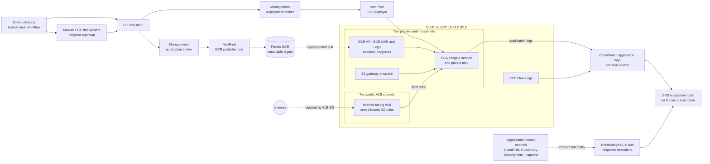

# Architecture

## Scope

This repository demonstrates a secure CI foundation and a private AWS ECS
runtime in a validated NonProd architecture. Stage 8 closes with the
application running on AWS Fargate, reachable by its load balancer only for
internal target-health traffic because public load-balancer ingress remains
disabled.

The design spans two conceptual account boundaries:

- a Management account hosts the GitHub OIDC trust and broker identity used by
  trusted GitHub Actions; and
- a NonProd account hosts the private ECR repository and Stage 8 runtime.

The account boundary prevents a GitHub-federated broker from receiving direct
runtime permissions. Separate role chains enter a dedicated NonProd ECR
publisher and a dedicated NonProd ECS deployer. The runtime uses a distinct,
least-privilege ECS task execution role. See
[CI/CD security controls](cicd-security-controls.md) for the complete trust and
permission model.

## System view

## Runtime network

The runtime VPC uses `10.42.0.0/16` across two Availability Zones:

- two public subnets contain the internet-facing ALB;
- two private subnets contain the Fargate task ENI and interface endpoints;
- an internet gateway is associated only with the public route table;
- there is no NAT gateway and neither private route table has a default route;
- private DNS is enabled for the ECR API, ECR DKR, and CloudWatch Logs
  interface endpoints; and
- an S3 gateway endpoint supplies private access to ECR image layers.

Traffic is constrained by security-group references and service endpoints:

- the ALB can send TCP/8000 only to the task security group;
- the task accepts TCP/8000 only from the ALB security group;
- the task can send TCP/443 only to the endpoint security group and the
  regional S3 prefix list;
- the task can query the VPC resolver over TCP/UDP 53; and
- the interface endpoints accept TCP/443 only from the task security group.

The task has no arbitrary internet egress path. The VPC default security group
has no ingress or egress rules.

## ECS runtime

The service runs one Fargate task with `0.25` vCPU and `0.5 GiB` memory on
Linux/X86_64. The task definition references the approved ECR image by digest,
not a mutable tag. The container runs as UID/GID `10001:10001`, has a read-only
root filesystem, is not privileged, and drops every Linux capability.

The task has no task role because the application needs no AWS API access. A
dedicated execution role permits only the ECR image-pull and CloudWatch Logs
delivery operations needed by the Fargate agent. The ECS service uses a
deployment circuit breaker with automatic rollback, keeps its task in private
subnets, and does not assign a public IP.

## Load balancer posture

The Application Load Balancer is internet-facing so that a later, separately
approved public-exposure stage can add TLS controls without replacing the load
balancer. Its target group uses IP targets, HTTP on port 8000, and `/health`.
The port 80 listener exists only to associate the target group before ECS
service creation.

The ALB security group has zero inbound rules. Consequently, the current
listener posture is `FAIL_CLOSED_HTTP_ASSOCIATION`: the target can be healthy
while the application remains unreachable from the public internet. HTTPS,
ACM, DNS, public ingress, redirect behavior, WAF, and ALB access logging are not
implemented in Stage 8.

## Observability and security services

Project-owned controls include:

- application logs in CloudWatch Logs;
- VPC Flow Logs for all accepted and rejected network flows;
- CloudWatch alarms for unhealthy targets, target HTTP 5XX responses, ECS CPU,
  and ECS memory;
- EventBridge rules for failure-oriented ECS stopped-task events and active
  HIGH/CRITICAL Inspector findings for the project ECR repository; and
- a source-restricted SNS integration topic.

The SNS topic has no human subscription, so notification delivery remains an
explicitly deferred integration step. CloudTrail, GuardDuty, Security Hub, and
Inspector are organization-owned account controls: this Terraform state
consumes their signals where applicable but does not own or configure them.

Control status and validation evidence are recorded in
[runtime security controls](runtime-security-controls.md) and
[Stage 8 runtime evidence](stage-8-runtime-evidence.md). The
[threat model](threat-model.md) covers the implemented continuous-deployment
boundary and its residual risks.

The continuous-deployment trust boundary, dedicated identities, and
Terraform/CD ownership seam are documented in the
[Stage 9 continuous deployment design](stage-9-cd-design.md). The capability
is implemented, while its first mutating ECS promotion remains separately
gated and deferred.
