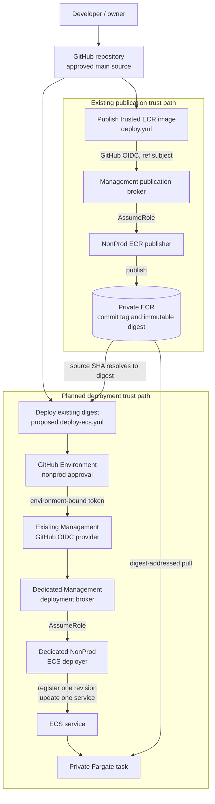

# Stage 9 Continuous Deployment Design

> Status: **DESIGN ONLY**. Stage 9.0 changes no workflow, Terraform source,
> GitHub setting, IAM policy, AWS resource, task definition, or ECS service.
> Controls described as planned or required are not yet implemented.

## Scope

Stage 9 will allow an explicitly authorized GitHub deployment workflow to
promote one already-published, immutable, approved ECR image digest into the
one existing NonProd ECS service. The deployment identity must not gain ECR
write, network mutation, IAM administration, general infrastructure mutation,
application task execution, public-exposure, or static-credential authority.

Stage 9 does not own VPCs, subnets, routes, security groups, endpoints, ALBs,
public ingress, ACM, Route 53, WAF, ECR publication, Terraform infrastructure
apply, business-application AWS permissions, or production deployment.

## Current Stage 8 Baseline

The reviewed source baseline is
`ec6b7c32863a64da9375f0f2a5839873d9c48d84`. CI run 37 and Security run 37
passed for that commit. Read-only Stage 9.0 discovery reconfirmed:

- runtime, Management identity, and NonProd identity Terraform plans had no
  changes;
- the ECS service was active with 1 desired, 1 running, and 0 pending tasks;
- the deployment and target were healthy;
- the running image reference was digest-pinned and the task had no task role;
- the ALB security group had zero inbound rules; and
- the dedicated Management and NonProd deployment roles did not exist.

The complete Stage 8 evidence remains in
[Stage 8 runtime evidence](stage-8-runtime-evidence.md).

## Publication vs Deployment Boundary

Publication and deployment are separate trust paths:

| Concern | Existing publication path | Planned deployment path |
| --- | --- | --- |
| Workflow | `.github/workflows/deploy.yml` | Proposed `.github/workflows/deploy-ecs.yml` |
| Operation | Build, scan, and publish | Promote an existing digest only |
| Management identity | Existing ECR publication broker | Dedicated ECS deployment broker |
| NonProd identity | Existing ECR publisher | Dedicated ECS deployer |
| ECR access | Write the exact repository | Read metadata/findings only |
| ECS access | None | Register one family revision and update one service |

The future deployment workflow must not rebuild or push an image. The existing
publisher, publication broker, and ECS execution role must not be reused as
deployment identities.



## Identity Architecture

Two options were evaluated:

| Option | Blast radius and separation | Complexity | Auditability | Decision |
| --- | --- | --- | --- | --- |
| A — expand the publication broker to assume a deployment role | Mixes publication and deployment authority in one GitHub-federated role; compromise affects both paths. | One fewer broker role and policy. | Shared sessions and trust obscure the operation boundary. | Rejected |
| B — dedicated Management deployment broker and dedicated NonProd deployer | Preserves separation of duties and keeps each cross-account edge single-purpose. | Adds one role/policy in each account. | Distinct role sessions, CloudTrail events, and trust conditions. | **Selected** |

The account-level `token.actions.githubusercontent.com` provider is already
owned by the Management identity Terraform state and will be reused. A second
OIDC provider must not be created.

The proposed NonProd role name is
`secure-cicd-pipeline-nonprod-ecs-deployer`. It will trust only the exact
dedicated Management deployment broker. It will have no direct GitHub trust,
human principal, account-root principal, or wildcard principal.

The Management deployment broker will be GitHub-federated and will permit only
`sts:AssumeRole` to that exact NonProd deployer role. It will have no direct ECR
or ECS permissions.

## OIDC / GitHub Environment Boundary

The selected Environment name is `nonprod`. The future AWS-authentication job
must reference that Environment, whose protection rules become the human
approval boundary.

The currently deployed publication subject is ref-based:

```text
repo:Nex-opensourcehorray@82328818/secure-cicd-pipeline@1409968457:ref:refs/heads/main
```

GitHub's current OIDC documentation confirms that an Environment replaces the
ref context in the default subject, and immutable-subject repositories retain
the owner and repository IDs. The planned deployment subject is therefore:

```text
repo:Nex-opensourcehorray@82328818/secure-cicd-pipeline@1409968457:environment:nonprod
```

The deployment broker trust must independently require:

```text
aud = sts.amazonaws.com
sub = exact environment subject above
repository_owner_id = 82328818
repository_id = 1409968457
ref = refs/heads/main
```

The documented subject format is **CONFIRMED**. Because the Environment does
not yet exist, Stage 9.1 must still capture and compare a real token's claims
before IAM creation. This is a `MUST VERIFY BEFORE IAM CREATION` gate, not
permission to weaken or wildcard the trust if a claim differs.

Reference: [GitHub OIDC subject and immutable-claim syntax](https://docs.github.com/en/actions/reference/security/oidc).

### Stage 9.1A implementation status

The dedicated deployment IAM source is merged but remains unapplied.
`.github/workflows/deployment-trust-check.yml` provides a manual,
Environment-bound token claim check without requesting AWS credentials or
assuming a role. The `nonprod` GitHub Environment does not yet exist at source
creation time and the workflow must not be dispatched until that separate
settings action is approved and completed. Deployment IAM creation remains
blocked until the live token's mandatory claims match the trust source.

## Deployment Role Permission Model

Placeholders below represent exact reviewed ARNs. A future policy must not
replace them with role, repository, cluster, service, or account wildcards.
The resource-scoping decisions follow the current
[Amazon ECS](https://docs.aws.amazon.com/service-authorization/latest/reference/list_ecs.html),
[Amazon ECR](https://docs.aws.amazon.com/service-authorization/latest/reference/list_ecr.html),
[Elastic Load Balancing V2](https://docs.aws.amazon.com/service-authorization/latest/reference/list_elbv2.html),
and [IAM PassRole](https://docs.aws.amazon.com/IAM/latest/UserGuide/id_roles_use_passrole.html)
authorization references.

| Action | Why required | Resource scoping | Intended resource / conditions | Decision |
| --- | --- | --- | --- | --- |
| `sts:AssumeRole` | Management broker enters the NonProd deployment role. | Supported | Exact NonProd deployer role ARN. | Required on broker only |
| `ecr:DescribeImages` | Resolve one full source-SHA tag to exactly one digest. | Repository supported | Exact `secure-cicd-demo` repository ARN. | Required |
| `ecr:DescribeImageScanFindings` | Recheck enhanced scan findings immediately before promotion. | Repository supported | Exact repository ARN. | Required |
| `ecs:DescribeServices` | Read current service/task revision and deployment state. | Service supported | Exact existing service ARN; exact-cluster condition where supported. | Required |
| `ecs:DescribeTaskDefinition` | Read and validate the current task definition. | Not supported | `Resource = "*"`; one read action, followed by exact family/invariant validation. | Required |
| `ecs:RegisterTaskDefinition` | Register the next revision after invariant validation. | Task-definition family supported | Exact family ARN/revision pattern; conditions require Fargate, CPU 256, memory 512, and non-privileged containers. | Required |
| `iam:PassRole` | Permit ECS to use the existing execution role during registration/update. | Role supported | Exact execution-role ARN with `iam:PassedToService = ecs-tasks.amazonaws.com`. | Required |
| `ecs:UpdateService` | Point the existing service to the newly registered revision. | Service supported | Exact service ARN; exact cluster and task-definition-family conditions. | Required |
| `ecs:ListTasks` | Enumerate the service's running task after stabilization. | Fargate enumeration requires wildcard request scope | `Resource = "*"` with exact `ecs:cluster`; CLI must provide exact cluster and service name. | Required |
| `ecs:DescribeTasks` | Verify running revision, digest, health, and task attachment. | Task supported | Task ARN pattern within the exact cluster plus exact-cluster condition. | Required |
| `elasticloadbalancing:DescribeTargetHealth` | Verify the newly deployed target is healthy. | Not supported | `Resource = "*"`; target-group ARN must come from the exact service and match the approved target group. | Required |
| `ec2:DescribeSecurityGroups` | Reconfirm that the approved ALB security group has zero ingress. | Not supported | `Resource = "*"`; read-only call uses the exact approved group ID. | Required read-only verification |
| `ecs:TagResource` | Could tag a new revision with provenance. | Supported | Not needed because workflow evidence records provenance. | Rejected |

`sts:GetCallerIdentity` is used to verify the active account and does not need
an identity-policy allow. Where AWS requires `Resource = "*"`, the policy must
contain only the named read action, and the workflow must validate the exact
logical resource before and after the call.

The policy must explicitly omit `ecs:RunTask`, `ecs:StopTask`, service/cluster
create or delete, task-definition deregistration, ECR write/delete,
load-balancer mutation, network mutation, log writes, IAM administration,
Secrets Manager, SSM, KMS administration, and Terraform apply permissions.

## Artifact Provenance

The workflow input is a full 40-character source commit SHA, not a tag, branch,
or digest supplied without provenance. The planned validation is:

1. check the strict lowercase hexadecimal full-SHA form;
2. check out trusted repository source with credentials disabled and full
   history available;
3. prove that the commit object exists in this repository;
4. prove with `git merge-base --is-ancestor` that it is reachable from trusted
   `main`;
5. resolve the exact ECR tag equal to that SHA;
6. require exactly one image detail and a `sha256:` digest;
7. use `ecr:DescribeImageScanFindings` against that digest;
8. require continuous scan status to be active and zero active HIGH/CRITICAL
   findings; and
9. construct the ECS image URI with `@sha256:...`, never with a tag.

The live Stage 9.0 test confirmed that the repository-scoped ECR API reports
continuous enhanced scanning. This approach avoids broad Inspector read
permission. If the scan state is absent, stale, incomplete, or returns a HIGH
or CRITICAL finding, deployment fails closed. A new finding after the check is
covered by continuous Inspector scanning and the existing EventBridge rule,
but remains a timing-window residual risk.

## Terraform vs CD Ownership

Current Terraform owns both `aws_ecs_task_definition.this` and the ECS
service's exact `task_definition` pointer. Three ownership options were
evaluated:

| Option | Result | Assessment |
| --- | --- | --- |
| A — Terraform owns the exact service pointer | Every external deployment creates expected Terraform drift and a later apply can revert it. | Not acceptable for continuous deployment |
| B — Terraform owns infrastructure and baseline task security; CD owns new revisions and the service revision pointer | Creates one narrow, explicit ownership seam while preserving all other drift detection. | **Selected** |
| C — remove/refactor task-definition ownership into a larger template or data-source system | Can centralize deployment ownership but materially increases source/state migration complexity. | Deferred; unnecessary for this NonProd design |

Before the first deployment, a separately reviewed Terraform change must add
this lifecycle boundary to the ECS **service only**:

```hcl
lifecycle {
  ignore_changes = [
    task_definition,
  ]
}
```

Terraform continues to own the cluster, service configuration, networking,
load balancer, IAM, observability, desired count, baseline task definition, and
task security configuration. CD owns new task-definition revisions and the
service's selected revision.

This is a deliberate deployment-state ownership boundary, not the prohibited
Stage 8 normalization workaround. `container_definitions`, `desired_count`,
`network_configuration`, `load_balancer`, security properties, and every other
service attribute must remain managed. `ignore_changes =
[container_definitions]` is prohibited.

## Task Definition Revision Strategy

The workflow must clone the task definition currently used by the exact
service rather than construct an arbitrary task definition. Before cloning, it
must fail closed unless all invariants match:

| Invariant | Required value |
| --- | --- |
| Family | `secure-cicd-pipeline-nonprod` |
| Compatibility/network | Fargate and `awsvpc` |
| CPU/memory | `256` / `512` |
| Execution role | Exact approved execution-role ARN |
| Task role | Absent |
| Runtime | Linux / X86_64 |
| Container | Exactly one required container named `secure-cicd-demo` |
| User | `10001:10001` |
| Privileged | `false` |
| Root filesystem | Read-only |
| Capabilities | Add none; drop `ALL` |
| Port | TCP/8000 only |
| Logging | `awslogs` to the exact application log group, Region, and stream prefix |
| Health check | Exact approved localhost `/health` command and timing |
| Fault injection | Disabled |

The current CLI/API model comparison identified these
`DescribeTaskDefinition` response-only fields, which must not be sent to
`RegisterTaskDefinition`:

```text
compatibilities
registeredAt
registeredBy
requiresAttributes
revision
status
taskDefinitionArn
```

The workflow must build an allowlisted registration object from the current
[RegisterTaskDefinition request model](https://docs.aws.amazon.com/AmazonECS/latest/APIReference/API_RegisterTaskDefinition.html),
not delete a few known fields from raw output. It must explicitly preserve the
validated family, container definition, volumes, placement constraints,
execution role, compatibility, network mode, CPU, memory, and runtime platform;
omit `taskRoleArn`; and set fault injection false. Unexpected optional input
fields must fail review rather than be silently discarded. Task-definition
tags are not selected, so `ecs:TagResource` is unnecessary.

After changing only the intended container's `image` value to the approved
digest URI, a semantic comparison must prove that no other registration field
changed.

## Deployment Sequence

1. A manual trusted-main run accepts one full source SHA.
2. The job enters GitHub Environment `nonprod` and waits for its approval.
3. Source ancestry and current CI/security expectations are validated.
4. GitHub OIDC assumes the dedicated Management deployment broker, with
   Management account allowlisting.
5. Role chaining assumes the dedicated NonProd deployer, with NonProd account
   allowlisting, then `GetCallerIdentity` confirms the account.
6. ECR resolves SHA to digest and the time-of-deploy vulnerability gate passes.
7. The exact service and current task definition are described and every
   security/runtime invariant passes.
8. An allowlisted payload changes only the image URI and registers one new
   revision.
9. `UpdateService` is invoked with only exact cluster, exact service, and the
   new task-definition ARN. It must not send desired count, networking,
   security groups, subnets, load balancer, deployment configuration,
   execute-command, capacity provider/launch type, discovery, or public-IP
   fields.
10. The workflow waits for service stability and performs the verification
    sequence below.

## Verification Sequence

After stability, the workflow must verify:

- service `ACTIVE`;
- desired/running/pending counts `1 / 1 / 0`;
- deployment rollout `COMPLETED`;
- service points to the expected new revision;
- running container reports the exact promoted image digest;
- target health is `healthy`;
- the running task has no public IP attachment;
- the approved ALB security group still has zero ingress; and
- all task-definition invariants still match.

An authenticated Terraform plan must subsequently show no unexpected drift;
the only externally owned value is the intentionally ignored ECS service
task-definition pointer. The deployment role receives no Terraform or state
access.

## Rollback Model

The ECS service already has the deployment circuit breaker and automatic
rollback enabled. The workflow relies on those controls, waits for service
stability, and fails if rollout or verification fails. It preserves the source
SHA, digest, old/new revisions, ECS events, and verification output.

Before updating, the workflow should also recheck the currently serving digest
because it is the automatic rollback target. A HIGH/CRITICAL finding on that
digest blocks the normal promotion path and requires an incident-specific
remediation decision. A vulnerability disclosed between that check and an
automatic rollback remains a residual risk.

Failure must not trigger resource destruction, network changes, repeated force
deployments, task-definition deregistration, public ingress, or automatic
security-control weakening. Stage 9.6 will deliberately validate failure and
rollback behavior under its own approval gate.

## Concurrency

The future workflow requires:

```yaml
concurrency:
  group: ecs-deployment-nonprod
  cancel-in-progress: false
```

This serializes promotions without cancelling an in-flight deployment when a
new request arrives.

Workflow permissions default to `contents: read`. Only the AWS-authentication
job receives `id-token: write`. No contents, packages, pull-request, actions,
or administration write permission is required. Every action must be pinned to
an immutable commit SHA. Shell/AWS CLI transformations are preferred for the
security-critical task-definition allowlist to avoid unnecessary action trust.

## Audit Evidence

The workflow summary and retained logs must record non-secret evidence:

- workflow run, actor, Environment approval, and source commit;
- main-ancestry result;
- ECR commit tag and immutable digest;
- scan status and severity decision;
- Management and NonProd account verification;
- current and newly registered task-definition revisions;
- invariant-check results and semantic image-only difference;
- service stability, running digest, target health, private-task, and
  fail-closed-ingress results; and
- circuit-breaker/rollback outcome if deployment fails.

CloudTrail records role assumptions, task-definition registration, PassRole,
and service update. Existing ECS events, application logs, Flow Logs, runtime
alarms, Inspector, and organization-owned Security Hub provide complementary
runtime evidence. Evidence must not include credentials, raw OIDC tokens, local
paths, private IPs, task IDs, or other unnecessary operational identifiers.

## Repository Variables

No static AWS credentials or new secrets are required.

Existing repository variables reused:

```text
AWS_REGION
AWS_MANAGEMENT_ACCOUNT_ID
AWS_NONPROD_ACCOUNT_ID
ECR_REPOSITORY
```

Proposed `nonprod` Environment variables:

```text
AWS_MANAGEMENT_DEPLOY_ROLE_ARN
AWS_NONPROD_ECS_DEPLOY_ROLE_ARN
ECS_CLUSTER_NAME
ECS_SERVICE_NAME
ECS_CONTAINER_NAME
ECS_EXECUTION_ROLE_ARN
ALB_SECURITY_GROUP_ID
```

The target-group ARN is derived from the exact ECS service response and must
match its sole load-balancer association. The account IDs and role/resource
identifiers are non-secret metadata, but their creation or modification remains
a separately approved GitHub-settings operation.

## Deferred Decisions

The following are prerequisites for later substages, not Stage 9.0 changes:

- validate a real `nonprod` Environment OIDC token before IAM creation;
- implement and plan the narrow Terraform service-pointer ownership boundary;
- implement the two dedicated roles and validate their policies with IAM
  Access Analyzer/policy simulation;
- create and protect the GitHub Environment;
- implement the workflow and exact task-definition allowlist;
- decide evidence retention appropriate for deployment runs; and
- address the existing lack of a human SNS subscription under its own gate.

## Stage 9 Substage Roadmap

| Stage | Planned outcome |
| --- | --- |
| 9.0 | CD architecture and IAM threat model |
| 9.1 | Dedicated deployment IAM foundation |
| 9.2 | Deployment workflow source foundation |
| 9.3 | GitHub Environment and approval gate |
| 9.4 | Digest-to-task-definition revision automation |
| 9.5 | First ECS deployment and stability validation |
| 9.6 | Failed-deployment/circuit-breaker rollback test |
| 9.7 | Supply-chain and least-privilege CD validation |
| 9.8 | Stage 9 closure |

No later substage is authorized by this design document.
